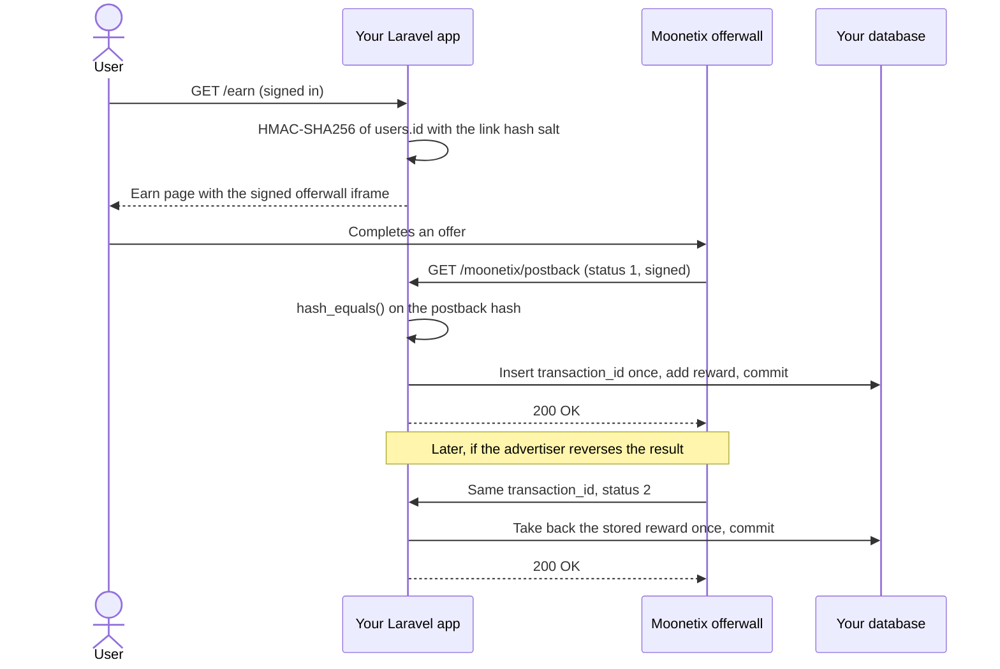

# Moonetix Offerwall for Laravel

**A Laravel 12 app with an Earn page and a postback route that credits every offer exactly once.**

[](https://github.com/moonetix/offerwall-laravel/actions/workflows/ci.yml)
[](LICENSE)
[](https://docs.moonetix.com/postbacks)
[](https://moonetix.com/register)
[](https://moonetix.com/academy/integrations/offerwall-php-laravel)
[](https://moonetix.com/integrations/website)

A small, complete Laravel app with the [Moonetix](https://moonetix.com) offerwall. The Earn page signs the offerwall link on the server for the signed-in user. The postback route verifies the hash, credits each `transaction_id` once, and takes back only what it credited. Moonetix is a pay-per-result affiliate network: your users earn your own currency by completing offers, and you earn per completed offer.

> **Get your App ID and keys: sign up free at https://moonetix.com/register**

## What you get

1. **Balances that stay right.** A unique key on `transaction_id` decides every credit. Retries, duplicates and late credits after a reversal pay nothing, and a reversal takes back the stored amount from the user who got it.
2. **Tested against real postbacks.** The 27 tests replay links and postbacks produced by the Moonetix code itself, including tampered, wrongly signed and malformed requests, and a database failure halfway through a credit.
3. **Copy what you need.** It is a full app so it runs and tests out of the box, but the integration itself is a handful of files. The table in [Add it to your own app](#add-it-to-your-own-app) lists them.

## How it fits together



## Quick start

You need PHP 8.2 or later with `pdo_sqlite`, and Composer.

```bash
git clone https://github.com/moonetix/offerwall-laravel.git
cd offerwall-laravel
composer install
composer run setup        # .env, app key, SQLite database, migrations
php artisan db:seed       # prints a demo user and a random password
php artisan serve         # http://127.0.0.1:8000
```

Put your keys in `.env`, then sign in at `/login` with the demo user and open `/earn`.

| Variable | Where to find it |
| --- | --- |
| `MOONETIX_APP_ID` | Dashboard, Offerwalls, your offerwall, Integration |
| `MOONETIX_LINK_SALT` | Same place: the link hash salt. Signs offerwall links. |
| `MOONETIX_POSTBACK_KEY` | Postback page: the postback secret key. Signs postbacks. |

Save this postback URL on the Postback page of your dashboard, with your real host:

```text
https://yoursite.com/moonetix/postback?tx={transaction_id}&user={user_id}&reward={reward}&status={status}&event={event_id}&payout={payout}&offer={offer_name}&hash={hash}
```

The offerwall iframe only loads on https pages of the website you registered for the app. On `http://127.0.0.1:8000` it stays blank, which is expected. Open the signed link in a new tab instead, or test on an https staging host.

## How it works

1. `GET /earn` needs a signed-in user. Until the user confirms they are 16 or older, no link is built.
2. `App\Support\Moonetix::wallUrl()` signs the user's `users.id` with the link hash salt (HMAC-SHA256, lowercase hex) and returns `https://wall.moonetix.com/{APP_ID}?user_id=...&hash=...`. A user ID sent by the browser is never used.
3. The Earn page sends `Cache-Control: private, no-store`, so no cache can hand one user's link to another.
4. Moonetix calls `GET /moonetix/postback` for every credit (status 1) and reversal (status 2). The route is loaded outside the `web` middleware group: no session, no cookies, no CSRF.
5. The controller computes the expected hash of `tx:user:reward:status` with the postback secret key and compares it with `hash_equals()`. A mismatch gets 403. Nothing else runs before this check.
6. Test postbacks from the dashboard (`transaction_id` starting with `test_`) are verified and logged, never credited.
7. In one database transaction, status 1 inserts the `transaction_id` with `insertOrIgnore` and adds the reward only if the insert happened. Status 2 flips a credited row to reversed and subtracts the stored amount. A reversal for a transaction that was never credited is recorded, so a late credit is not paid.
8. The answer is 200 only after the commit. Any error rolls back and Laravel answers 500, so Moonetix retries.

## Add it to your own app

| File | What to do |
| --- | --- |
| `app/Support/Moonetix.php` | Copy. Signs links, checks hashes, converts amounts. |
| `app/Http/Controllers/MoonetixPostbackController.php` | Copy. Adjust `findUser()` if your user IDs are not integers. |
| `app/Http/Controllers/EarnController.php` and `resources/views/earn.blade.php` | Copy, then use your own layout. |
| `app/Models/MoonetixTransaction.php` | Copy. |
| `database/migrations/2026_11_11_*` | Copy both, then `php artisan migrate`. |
| `routes/moonetix.php` and the `then:` callback in `bootstrap/app.php` | Copy. Loads the postback route without session or CSRF. |
| `config/services.php` | Add the `moonetix` block. |

Skip `LoginController`, `login.blade.php` and the seeder: they only exist so this example runs on its own. Keep your own authentication. The code was tested on Laravel 12.72.0. It only uses APIs that Laravel 11 also has, but it was not run on 11 here.

Balances are stored in `users.balance_micro` as whole millionths of a coin, in a signed 64-bit integer. Decimal rewards such as `0.75` and `1.23456` add up exactly on SQLite, MySQL and PostgreSQL, with no floating point.

## Security notes

- The link hash salt and the postback secret key come only from environment variables, read through `config()`. They never reach a page. Never commit `.env`.
- The postback hash is checked first, with `hash_equals()`. Values are hashed exactly as they arrived. A parameter sent as an array fails the check.
- `transaction_id` has a unique index. The credit is decided by the insert, not by a read before it, so two copies arriving at the same time still pay once.
- A reversal only flips a row that is credited, and subtracts the amount stored with the credit. It can take a balance below zero if the user already spent the coins. Say in your terms that rewards can be taken back.
- `payout`, `event`, `offer` and the other macros are not signed. The example stores the offer name for display only.
- Do not put the postback route behind `auth`, a redirect (http to https, trailing slash) or a per-IP rate limit. Moonetix does not follow redirects, and every postback comes from the same servers.
- Reward users only for completed offers. Never for sign-ups, invites, likes, reviews or other engagement. Users must be 16 or older.
- SQLite is fine for the demo. In production use MySQL, MariaDB or PostgreSQL.

## Test it locally

```bash
cp .env.example .env    # if you have not run composer run setup
php artisan test
```

```text
Tests:    27 passed (116 assertions)
```

The fixtures in `tests/Fixtures/moonetix-vectors.json` were produced by the Moonetix link and postback code with fake test keys (`demoapp0000000000000001`, `test_link_salt_not_secret`, `test_postback_key_not_secret`). The tests check:

- the signed link matches the Moonetix link for four user IDs, including one that needs URL encoding;
- the Earn page redirects guests, builds no link before the age check, ignores a `user_id` in the query string, sends `no-store`, and never prints a key;
- credit, retry, decimal and large rewards, reversal, repeated reversal, credit after reversal, reversal before any credit, negative balance after a reversal, `test_` postbacks, unknown users;
- 403 for a wrong key, a changed reward, user, transaction or status, an uppercase or missing hash, and array parameters; 405 for POST;
- 500 when the key is missing or the database fails, with nothing half applied.

To send a signed postback by hand to `php artisan serve`, with your key in `MOONETIX_POSTBACK_KEY` and demo user 1:

```bash
TX=local_1 U=1 R=150 S=1
HASH=$(php -r 'echo hash_hmac("sha256", $argv[1], getenv("MOONETIX_POSTBACK_KEY"));' "$TX:$U:$R:$S")
curl -i "http://127.0.0.1:8000/moonetix/postback?tx=$TX&user=$U&reward=$R&status=$S&hash=$HASH"
```

Run it twice: the balance goes up once. Set `S=2` and run it again: the 150 coins come back off.

## Test it with Moonetix

1. Deploy to a public https host and save the postback URL above on the Postback page.
2. Open Offerwalls, your offerwall, Integration. Under Integration status, use Check a link: type user ID `1` into Test a link and compare it with the iframe `src` on your Earn page. They must be identical.
3. Click **Send a test postback**, once with status 1 and once with status 2. The result window should show 200 and `Test postback: hash OK, nothing credited`. You can also send one from the Postback page.
4. Every attempt and your server's answer are listed under Reports, Postbacks.
5. Open the offerwall from a normal home or mobile connection. VPNs, proxies, Tor and data center networks see a block page.

## Learn more

- Academy: [Offerwall PHP integration: Laravel and plain PHP](https://moonetix.com/academy/integrations/offerwall-php-laravel)
- Academy: [Postback security](https://moonetix.com/academy/traffic-quality/postback-security) and [Prevent duplicate reward credits](https://moonetix.com/academy/integrations/prevent-duplicate-reward-credits)
- Academy: [How to write an earn page that converts](https://moonetix.com/academy/monetization/earn-page-that-converts)
- Moonetix for websites: [moonetix.com/integrations/website](https://moonetix.com/integrations/website) and [rewards sites](https://moonetix.com/industries/rewards-sites)
- Docs: [Offerwall link](https://docs.moonetix.com/offerwall-link), [Postbacks](https://docs.moonetix.com/postbacks), [Credits and reversals](https://docs.moonetix.com/credits-and-reversals), [Testing](https://docs.moonetix.com/testing)
- Free tools: [Offerwall link builder](https://moonetix.com/tools/offerwall-link-builder) and [Postback hash checker](https://moonetix.com/tools/postback-hash-checker)

## Get started

**Get your App ID and keys: sign up free at https://moonetix.com/register**

Every publisher application is reviewed by hand. Once you are approved, add your website as an app, set your currency name and rate, and paste the keys into `.env`.

## More Moonetix examples

| Repo | What it is |
| --- | --- |
| [awesome-offerwalls](https://github.com/moonetix/awesome-offerwalls) | Curated offerwall resources and guides |
| [offerwall-postback-handlers](https://github.com/moonetix/offerwall-postback-handlers) | Postback handlers in PHP, Node.js, Python and Java |
| [offerwall-nextjs-starter](https://github.com/moonetix/offerwall-nextjs-starter) | Next.js starter with a signed offerwall link |
| [telegram-mini-app-offerwall](https://github.com/moonetix/telegram-mini-app-offerwall) | Telegram Mini App with an offerwall |
| [discord-rewards-bot](https://github.com/moonetix/discord-rewards-bot) | Discord bot that rewards offer completions |
| [moonetix-offerwall-wordpress](https://github.com/moonetix/moonetix-offerwall-wordpress) | WordPress plugin |
| [offerwall-laravel](https://github.com/moonetix/offerwall-laravel) | Laravel Earn page and postback route |
| [offerwall-django](https://github.com/moonetix/offerwall-django) | Django Earn page and postback view |
| [offerwall-express](https://github.com/moonetix/offerwall-express) | Express 5 Earn page and postback route |

## License

MIT. See [LICENSE](LICENSE).
